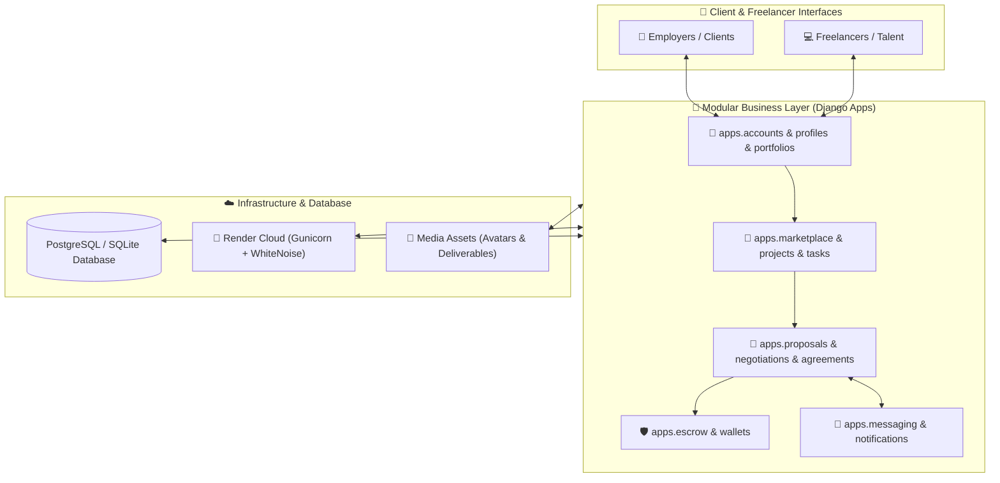
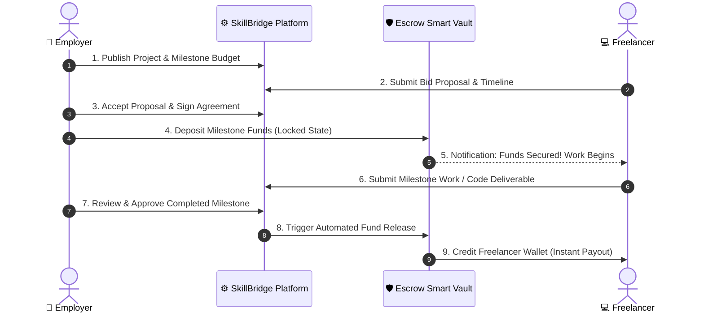

<div align="center">

# 🌉 SkillBridge — Enterprise Freelance Marketplace & Escrow Platform

[](https://skillbridge-1-7gc1.onrender.com/)
[](https://www.djangoproject.com/)
[](https://www.python.org/)
[](https://www.postgresql.org/)
[](#)
[](https://render.com/)
[](#)

<p align="center">
  <b>A comprehensive, production-grade freelance marketplace and contract ecosystem built with Django.</b>
  <br />
  Designed with milestone-based financial escrow protection, interactive negotiations, threaded client messaging, and end-to-end task tracking.
</p>

[🌐 Live Demo Application](https://skillbridge-1-7gc1.onrender.com/) • [✨ Features](#-key-features) • [🛠️ Tech Stack](#️-comprehensive-tech-stack) • [🚀 How to Run](#-complete-how-to-run--installation-guide) • [🏗️ Architecture](#️-2d3d-system-architecture)

---

</div>

## 📌 About the Project

**SkillBridge** solves the fundamental trust dilemma in freelance contracting: *Will the freelancer deliver quality work?* and *Will the client pay on time?*

By decoupling payments into **milestone-funded escrow vaults**, clients pre-fund milestones before work commences, while funds remain locked until deliverables are reviewed and verified. Built following strict **Agile Scrum methodology** (Sprint 4 & Sprint 5 test verified), SkillBridge provides a transparent, secure environment for employers and remote professionals.

---

## 🛠️ Comprehensive Tech Stack

| Domain | Technology | Version / Spec | Purpose & Responsibility |
| :--- | :--- | :--- | :--- |
| **Backend Framework** | **Django** | `5.0+` | Core MVC framework, URL routing, ORM, and authentication |
| **Programming Language** | **Python** | `3.11+` | Business logic, backend controllers, and unit testing |
| **Production Database** | **PostgreSQL** | `15+` | Scalable relational storage (`psycopg2-binary`, `dj-database-url`) |
| **Development Database** | **SQLite3** | Native | Zero-configuration local development and rapid prototyping |
| **Automated E2E Testing**| **Selenium** | `>=4.20.0` | Browser simulation, UI validation, and user journey testing |
| **WSGI / App Server** | **Gunicorn** | `>=21.2.0` | Production WSGI HTTP server powering Render web service |
| **Static Asset Engine** | **WhiteNoise** | `>=6.6.0` | Production static file serving without external CDN dependencies |
| **Image Processing** | **Pillow** | `>=10.0.0` | User avatar optimization, portfolio image thumbnailing |
| **Frontend UI / UX** | **HTML5 + CSS3 + JS** | Modern ES6+ | Responsive layout, custom glassmorphism, dynamic DOM updates |
| **Cloud Hosting** | **Render** | IaC (`render.yaml`) | Automated Git-driven continuous deployment pipeline |

---

## 🏗️ 2D/3D System Architecture



---

## 🔒 Financial Escrow Workflow



---

## ✨ Key Features

- **🛡️ Milestone Escrow Protection**: Safeguards payments for both parties until deliverables meet acceptance criteria.
- **💼 Dynamic Job Marketplace**: Post listings with tags, budget boundaries (fixed/hourly), and timeline expectations.
- **🤝 Proposal & Real-Time Negotiation**: Counter-offer terms, adjust milestones, and execute binding digital agreements.
- **💳 Multi-Party In-App Wallets**: Instant ledger accounting with credit/debit transaction histories and payout requests.
- **💬 Direct Project Messaging**: Built-in threaded discussions between clients and freelancers for seamless coordination.
- **⭐ Reputation & Review Engine**: Verified post-contract ratings and feedback scoring to establish user credibility.

---

## 📂 Repository Layout

```plaintext
Skillbridge-Project/
├── 📁 apps/                     # Modular Django applications
│   ├── 📁 accounts/            # User authentication, registration & role control
│   ├── 📁 profiles/            # Extended user metadata & bio profiles
│   ├── 📁 portfolios/          # Media-rich freelancer showcase portfolios
│   ├── 📁 marketplace/         # Searchable project marketplace & categories
│   ├── 📁 projects/            # Project lifecycle models, statuses, deliverables
│   ├── 📁 tasks/               # Sub-task checklists and Kanban status trackers
│   ├── 📁 proposals/           # Freelancer bidding and application submissions
│   ├── 📁 negotiations/        # Interactive bid counter-proposals and terms
│   ├── 📁 agreements/          # Digital contracts binding client & freelancer
│   ├── 📁 escrow/              # Financial lock mechanisms and release logic
│   ├── 📁 wallets/             # In-app wallet balances, top-ups, and logs
│   ├── 📁 messaging/           # Threaded in-app chat between counterparties
│   ├── 📁 notifications/       # Real-time event notifications & email hooks
│   └── 📁 core/                # Shared mixins, constants, and custom decorators
├── 📁 config/                   # Root Django configuration & URL routing
├── 📁 Sprint_4_Test/            # Agile Sprint 4 Selenium & unit test suites
├── 📁 Sprint_5_Test/            # Agile Sprint 5 Escrow & settlement test suites
├── 📄 render.yaml               # Infrastructure-as-code for Render deployment
├── 📄 build.sh                  # Render automated build & migration script
├── 📄 Procfile                  # Production process definition
├── 📄 requirements.txt          # Python runtime dependencies
└── 📄 manage.py                 # Django administrative command-line runner
```

---

## 🚀 Complete How-To-Run & Installation Guide

Follow these steps to run the complete SkillBridge project locally on your machine.

### 1. Prerequisites
Ensure you have the following installed:
- **Python 3.10 or 3.11+** (`python --version`)
- **Git** (`git --version`)
- **Pip & Virtualenv** (`pip --version`)

---

### 2. Step-by-Step Installation

#### Step 1: Clone the Repository
```bash
git clone https://github.com/MominRifat/Skillbridge-Project.git
cd Skillbridge-Project
```

#### Step 2: Set Up Virtual Environment
```bash
# On Windows (PowerShell / Command Prompt):
python -m venv venv
.\venv\Scripts\activate

# On macOS / Linux:
python3 -m venv venv
source venv/bin/activate
```

#### Step 3: Install Required Dependencies
```bash
pip install --upgrade pip
pip install -r requirements.txt
```

#### Step 4: Configure Environment Variables
Copy the sample environment file to create your local `.env`:
```bash
# Windows:
copy .env.example .env

# macOS / Linux:
cp .env.example .env
```
*(Default settings use SQLite automatically if no external PostgreSQL `DATABASE_URL` is provided.)*

#### Step 5: Execute Database Migrations
```bash
python manage.py makemigrations
python manage.py migrate
```

#### Step 6: Create an Administrator Account
```bash
python manage.py createsuperuser
```
*Follow the terminal prompts to set your Admin username, email, and password.*

#### Step 7: Launch the Development Server
```bash
python manage.py runserver
```

Now open your web browser and navigate to:  
👉 **`http://127.0.0.1:8000/`**  
*(Admin Panel is accessible at `http://127.0.0.1:8000/admin/`)*

---

### 3. Running Automated Tests

SkillBridge includes comprehensive test suites covering user journeys, escrow security, and Selenium browser automation:

```bash
# Run all unit tests
python manage.py test

# Run tests for specific modules (e.g. Accounts & Escrow)
python manage.py test apps.accounts
python manage.py test apps.escrow

# Run Sprint verification tests
python manage.py test Sprint_4_Test
python manage.py test Sprint_5_Test
```

---

## 🌐 Live Cloud Deployment

SkillBridge is deployed live on Render:  
🔗 **[https://skillbridge-1-7gc1.onrender.com/](https://skillbridge-1-7gc1.onrender.com/)**

To deploy your own fork on Render:
1. Connect your GitHub repository to [Render.com](https://render.com/).
2. Select **Web Service** and choose **Python** runtime.
3. Set **Build Command**: `./build.sh`
4. Set **Start Command**: `gunicorn config.wsgi:application`
5. Add a managed PostgreSQL database and link `DATABASE_URL`.

---

## 👨‍💻 Authors & Academic Contributors

- **Momin Rifat** ([@MominRifat](https://github.com/MominRifat)) — University of Asia Pacific (UAP)
- Upstream Base: [Siam-2004/SkillBridge](https://github.com/Siam-2004/SkillBridge)
