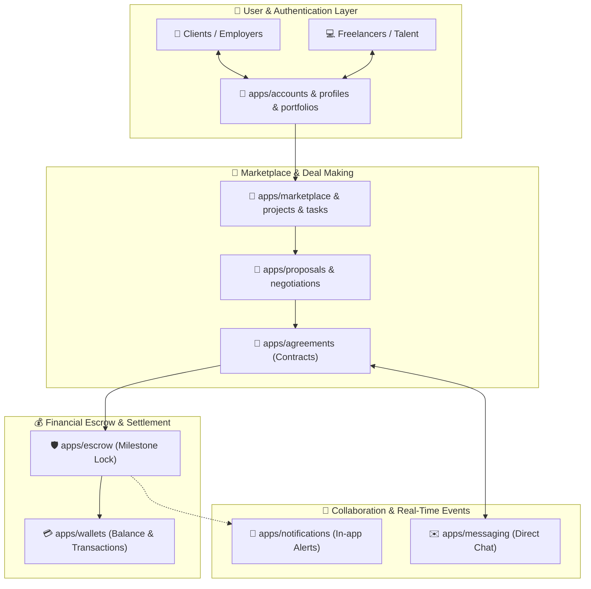
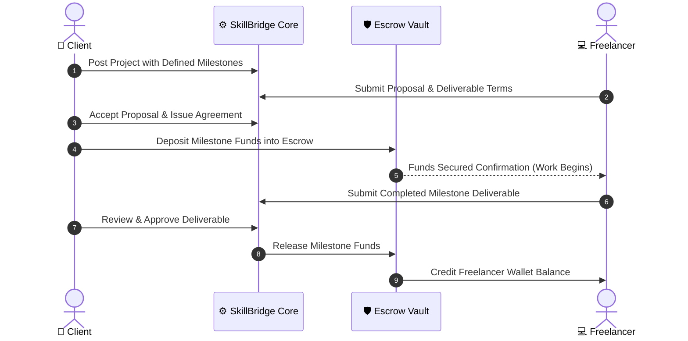

<div align="center">

# 🌉 SkillBridge — Enterprise Freelance Marketplace & Escrow Platform

[](https://www.python.org/)
[](https://www.djangoproject.com/)
[](https://render.com/)
[](#)
[](#)

<p align="center">
  <b>A full-featured, secure digital marketplace connecting skilled freelancers with clients worldwide.</b>
  <br />
  Engineered with milestone-based escrow contracts, integrated wallet accounting, real-time negotiation pipelines, and end-to-end task tracking.
</p>

---

</div>

## 📌 Executive Overview

**SkillBridge** is a modern solution to freelance engagement risks. By combining a granular modular application architecture with an automated escrow safeguard, SkillBridge ensures that clients only pay for verified milestones while freelancers have guaranteed payment protection prior to project commencement.

---

## 🏛️ 2D/3D Multi-App Architecture & Ecosystem



---

## 🔒 The Escrow Safeguard Workflow



---

## 🧩 Modular Applications Breakdown

| Module | Core Responsibility |
| :--- | :--- |
| **`accounts` / `profiles`** | Custom user types, biometric profile data, KYC verification, and user state management. |
| **`portfolios`** | Multimedia portfolio project showcases and case studies for freelancers. |
| **`marketplace` / `projects`** | Project listings, budget brackets, skill tag filters, and task breakdown. |
| **`proposals` / `negotiations`** | Bid proposals, milestone timeline negotiation, and contract finalization. |
| **`agreements`** | Legal engagement contracts binding terms, deadlines, and deliverables. |
| **`escrow` / `wallets`** | Multi-party financial ledger, fund locking, payout verification, and refund dispute logic. |
| **`messaging`** | Contextual project chat channels between employers and freelancers. |
| **`notifications`** | Event-driven triggers for bids, milestones, payouts, and status updates. |

---

## 🏃 Agile Scrum Sprint Testing

The codebase has undergone iterative test-driven development:
- **Sprint 4 Test Suite**: Validated user profiles, project postings, proposal submissions, and contract agreements.
- **Sprint 5 Test Suite**: End-to-end verification of the escrow lifecycle, wallet balance credits, and dispute resolutions.

---

## ⚡ Deployment & Local Installation

### 1. Requirements
- **Python 3.11+**
- **Virtualenv** / Pip

### 2. Local Setup
```bash
# Clone the repository
git clone https://github.com/MominRifat/Skillbridge-Project.git
cd Skillbridge-Project

# Create and activate virtual environment
python -m venv venv
# On Windows:
venv\Scripts\activate
# On Linux/macOS:
source venv/bin/activate

# Install dependencies
pip install -r requirements.txt

# Run migrations & populate initial data
python manage.py makemigrations
python manage.py migrate

# Launch local development server
python manage.py runserver
```
*Visit the portal at `http://127.0.0.1:8000/`.*

### 3. Cloud Deployment (Render / Heroku)
The repository includes native deployment artifacts:
- **`render.yaml`**: Infrastructure-as-code configuration for Render web service & PostgreSQL.
- **`build.sh`**: Automatic static compilation (`collectstatic`) and migration runner.
- **`Procfile`**: Production WSGI/Gunicorn entry point (`web: gunicorn config.wsgi:application`).

---

## 👨‍💻 Contributors & Authors

- **Momin Rifat** ([@MominRifat](https://github.com/MominRifat))
- Original Project: [Siam-2004/SkillBridge](https://github.com/Siam-2004/SkillBridge)
